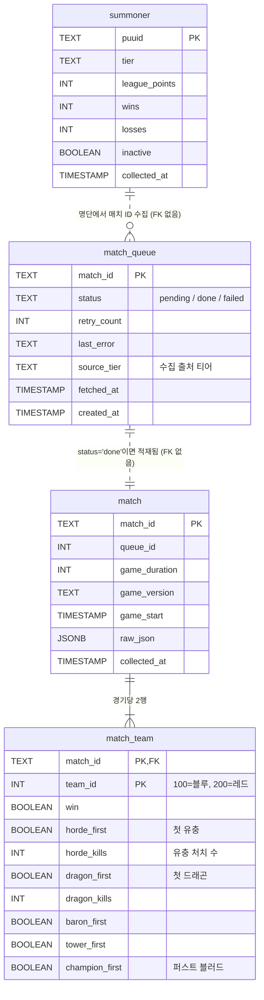

# LoL 초반 오브젝트 분석 파이프라인

Riot API로 한국 서버 솔로랭크(큐 420) 경기를 수집해 PostgreSQL에 적재하고,
**초반 오브젝트(공허 유충 vs 첫 드래곤)가 승률에 미치는 영향**을 티어별로 비교하는 프로젝트다.

핵심 질문은 하나다.

> 한 팀이 **공허 유충 3마리**를 가져가고 다른 팀이 **첫 드래곤**을 가져간 경기에서, 어느 쪽이 유리한가?

---

## 아키텍처

```
┌──────────────┐
│   Riot API   │  league-v4 (소환사 명단) / match-v5 (매치 ID, 매치 상세)
└──────┬───────┘
       │ requests (rate limit 대응: sleep 1.0~1.3s, 429 시 Retry-After 대기)
       ▼
┌──────────────┐
│    Python    │  src/*.py — 수집 스크립트
│  (psycopg2)  │  큐 테이블 기반 재시도 구조
└──────┬───────┘
       │ INSERT ... ON CONFLICT DO NOTHING / DO UPDATE
       ▼
┌──────────────┐
│  PostgreSQL  │  lol_db — summoner / match_queue / match / match_team
└──────┬───────┘
       │ SQL 집계
       ▼
     분석 결과

  ⏱ Airflow (Docker Compose, CeleryExecutor)
     dag: lol_daily_pipeline — 매일 04:00 UTC
     collect_summoners → collect_match_ids → collect_matches → validate
```

수집은 **작업 큐 패턴**으로 돌아간다. 매치 ID를 먼저 `match_queue`에 `pending`으로 쌓아두고,
본문 수집기가 배치로 꺼내 처리하면서 `done` / `failed`로 상태를 갱신한다.
API 키 만료(401/403)를 만나면 실패로 기록하지 않고 즉시 중단하므로,
키를 갱신한 뒤 다시 실행하면 남은 `pending`부터 이어서 수집한다.

---

## ERD



`summoner → match_queue`, `match_queue → match` 관계는 논리적 흐름일 뿐 실제 외래키 제약은 없다.
`match_team`만 `match(match_id)`를 참조한다.

### 스키마 파일

| 파일 | 내용 |
|---|---|
| `sql/001_create_tables.sql` | 4개 테이블 + `match_queue(status)` 인덱스 생성 |
| `sql/002_add_source_tier.sql` | `match_queue.source_tier` 컬럼 추가, 기존 행은 `CHALLENGER_GM`으로 백필 |

---

## 각 스크립트의 역할

### 수집 (`src/`)

| 파일 | 역할 |
|---|---|
| `collect_summoners.py` | league-v4로 **챌린저 / 그랜드마스터** 전체 명단을 `summoner`에 upsert |
| `collect_master.py` | **마스터** 리그 상위 1,000명을 `summoner`에 넣고, 각자 최근 20경기 ID를 `source_tier='MASTER'`로 큐에 적재 |
| `collect_lower_tiers.py` | **마스터 / 다이아 I / 에메랄드 I** 각 450명을 페이지네이션으로 확보 → 명단 저장 + 매치 ID 큐 적재까지 한 번에 처리 |
| `collect_match_ids.py` | `summoner`에서 `inactive=false`인 전원의 최근 20경기(큐 420) ID를 `match_queue`에 `pending`으로 적재 |
| `collect_matches.py` | 큐에서 `pending`을 500건씩 꺼내 match-v5 상세를 받아 `match`(raw JSON 포함) + `match_team` 2행에 저장. 429는 `Retry-After`만큼 대기 후 최대 3회 재시도, 401/403은 즉시 중단 |
| `explore_tier.py` | 다이아 I 100명을 샘플링해 **매치 ID 중복률**과 1인당 고유 경기 수를 측정 — 티어별 목표 인원을 정하기 위한 사전 조사 |
| `analyze.py` | `sql/analysis/*.sql`을 순서대로 실행해 추정치 사다리(1~4단계)를 재현하고, 티어 간 차이에 대한 통계 검정(카이제곱·선형 추세·로지스틱 회귀)까지 출력 |

리포지토리 루트의 `explore.py`는 단일 경기 JSON 구조를 눈으로 확인하려고 쓴 임시 스크립트다.

### 분석 (`sql/analysis/`)

| 파일 | 역할 |
|---|---|
| `00_create_view.sql` | `v_match_pivot` 뷰 — 경기당 2행인 `match_team`을 1행으로 피벗 (유충팀·드래곤팀·승리팀·진영) |
| `01_naive.sql` | 1단계 단순 집계 (유충 1마리 이상) |
| `02_horde3.sql` | 2단계 유충 3마리 한정 + 15분 미만 경기 제외 |
| `03_side_controlled.sql` | 3~4단계 진영 층화 — 드래곤 이득과 블루 이득을 분리 |
| `04_contingency.sql` | 티어 × 진영 × 승패 분할표 (검정용) |

```bash
python src/analyze.py    # 뷰 생성 → 4단계 재현 → 통계 검정까지 한 번에
```

### 오케스트레이션 (`airflow/dags/`)

| 파일 | 역할 |
|---|---|
| `lol_pipeline.py` | `lol_daily_pipeline` DAG. `collect_summoners → collect_match_ids(100명) → collect_matches(300건) → validate` 순차 실행. 매일 04:00 UTC, `catchup=False`, `max_active_runs=1`, 태스크당 재시도 2회(5분 간격) |
| `hello_dag.py` | Airflow 환경 확인용 테스트 DAG (`hello_lol`) |

`validate` 태스크는 **`match_team` 행이 정확히 2개가 아닌 경기**가 있으면 예외를 던져 DAG를 실패시킨다.
DAG 안의 수집 로직은 `src/`와 동일한 내용을 컨테이너에서 돌리기 위해 인라인으로 복제한 것이고,
DB 호스트만 `host.docker.internal`로 다르다.

---

## 실행 방법

### 사전 준비

- Python 3.11+, PostgreSQL 16, Docker (Airflow용)
- Riot Developer API 키

```bash
pip install requests psycopg2-binary python-dotenv
```

루트에 `.env`를 만든다.

```dotenv
RIOT_API_KEY=RGAPI-xxxxxxxx
DB_PASSWORD=your_postgres_password
```

### 1. DB 초기화

```bash
createdb -U postgres lol_db
psql -U postgres -d lol_db -f sql/001_create_tables.sql
psql -U postgres -d lol_db -f sql/002_add_source_tier.sql
```

### 2. 수동 수집

```bash
# 챌린저 + 그랜드마스터 명단
python src/collect_summoners.py

# 명단 전원의 매치 ID를 큐에 적재
python src/collect_match_ids.py

# 하위 티어까지 확장 (마스터 / 다이아 I / 에메랄드 I)
python src/collect_master.py
python src/collect_lower_tiers.py

# 큐에 쌓인 매치 상세 수집 (개인 키 기준 수천 건에 수 시간 소요)
python src/collect_matches.py
```

진행 상황은 `collect.log`와 표준 출력에 동시에 남는다.
중간에 끊겨도 `collect_matches.py`를 다시 실행하면 `pending`부터 이어서 처리한다.

실패 건 재시도:

```sql
UPDATE match_queue SET status = 'pending' WHERE status = 'failed';
```

### 3. Airflow 스케줄링

`airflow/.env`에 `AIRFLOW_UID`, `FERNET_KEY`, `RIOT_API_KEY`, `DB_PASSWORD`를 넣고:

```bash
cd airflow
docker compose up airflow-init
docker compose up -d
```

`http://localhost:8080` 접속 → `lol_daily_pipeline` DAG를 unpause.
컨테이너에서 호스트 PostgreSQL에 붙으므로 `host.docker.internal` 접근이 가능해야 한다.

---

## 분석 결과

### 수집 규모

| 항목 | 값 |
|---|---|
| 총 수집 경기 | **35,685경기** |
| 수집 실패 | 14건 |
| 대상 티어 | 챌린저 + 그랜드마스터 / 마스터 / 다이아몬드 I / 에메랄드 I |

### 분석 조건

| 항목 | 정의 |
|---|---|
| 대상 경기 | 한 팀 `horde_kills = 3`, **다른** 팀 `dragon_first = true` |
| 제외 | `game_duration < 900` (15분 미만 리메이크·조기 항복 709경기) |
| 지표 | 이득(%p) = 드래곤팀 승률 − 유충팀 승률 = 2 × (드래곤팀 승률 − 50) |
| 진영 통제 | 드래곤팀이 블루인 경기(pB)와 레드인 경기(pR)로 층화 후<br>드래곤 이득 = pB + pR − 100, 블루 이득 = pB − pR |

### 결론: 유충 3마리보다 첫 드래곤

한 팀이 유충 3마리를 확보하고 상대가 첫 드래곤을 가져간 경기에서,
**진영을 통제한 뒤 드래곤 팀의 승률 이득**은 다음과 같다.

| 티어 | 드래곤 팀 승률 이득 |
|---|---:|
| 챌린저 + 그랜드마스터 | +6.68%p |
| 마스터 | +6.27%p |
| 다이아몬드 I | +8.98%p |
| 에메랄드 I | +10.34%p |

모든 티어에서 첫 드래곤 쪽이 유리하고, 낮은 티어일수록 이득이 커 보인다.
다만 **티어 간 차이 자체는 통계적으로 확정적이지 않다 (p ≈ 0.14).**
"낮은 티어일수록 드래곤이 더 중요하다"는 방향성은 보이지만, 이 표본으로는 단정할 수 없다.

참고로 **블루 진영 자체의 승률 이득**은 챌린저+그마 2.80%p에서 에메랄드 I 6.04%p까지 나타났다.
이 값이 분석의 핵심 함정이었다 — 아래 참조.

### 추정치가 수정된 과정

숫자가 처음부터 6.68%p였던 건 아니다. 교란 요인을 하나씩 걷어내면서 네 번 바뀌었다.

| 단계 | 처리 | 추정치 |
|---|---|---:|
| 1 | 단순 집계 | **10.9%p** |
| 2 | 유충 3마리 확보로 한정 | **3.8%p** |
| 3 | 진영(블루/레드) 통제 | **5.05%p** |
| 4 | 표본 확대 (하위 티어 포함) | **6.68%p** |

**1 → 2.** 처음엔 "유충을 가져간 팀 vs 첫 드래곤 팀"으로 단순 비교해 10.9%p가 나왔다.
그런데 이 집단에는 유충을 **1~2마리만** 먹은 팀이 섞여 있었다.
유충의 가치는 3마리를 다 모아 쐐기를 얻을 때 나오는데, 덜 먹은 팀까지 "유충 팀"에 넣으니
유충 쪽 승률이 낮게 깔렸고 그만큼 드래곤의 이득이 과대 추정됐다.
`horde_kills = 3`으로 한정하자 3.8%p로 내려갔다.

**2 → 3.** 그다음 진영을 확인했더니 문제가 하나 더 있었다.
**레드 진영이 첫 드래곤을 가져가는 비율이 높고, 동시에 레드 진영은 그 자체로 불리한 진영이다.**
즉 드래곤 팀에 "불리한 진영"이라는 페널티가 얹혀 있어서, 드래곤의 진짜 효과가 가려져 있었다.
진영을 통제하자 값이 3.8%p → 5.05%p로 **올라갔다**. 교란 변수가 효과를 깎아먹고 있던 셈이다.

**3 → 4.** 마지막으로 마스터·다이아 I·에메랄드 I를 추가해 표본을 35,685경기로 늘리자
챌린저+그마 기준 추정치가 6.68%p로 안정됐다.

교훈은 단순하다. **조건을 정확히 정의하고(1→2), 교란 변수를 통제해야(2→3) 숫자를 믿을 수 있다.**
게다가 통제는 효과를 줄이는 방향으로만 작동하지 않는다 — 3번 단계처럼 오히려 키우기도 한다.

### 재현 상태

위 수치는 원래 별도 대화에서 임시로 돌린 쿼리의 결과였고, 쿼리 자체는 남아 있지 않았다.
스키마와 위 서사만으로 쿼리를 재구성해 `sql/analysis/`에 커밋했고, 현재 DB(35,685경기)에 대해
`python src/analyze.py`로 대조한 결과는 다음과 같다.

| 항목 | 원본 | 재현 | |
|---|---:|---:|---|
| 총 경기 / 실패 | 35,685 / 14 | 35,685 / 14 | ✅ |
| 1단계 단순 집계 | 10.9%p | 10.89%p | ✅ |
| 4단계 챌+그마 | 6.68%p | 6.68%p | ✅ |
| 4단계 마스터 | 6.27%p | 6.27%p | ✅ |
| 4단계 다이아 I | 8.98%p | 8.98%p | ✅ |
| 4단계 에메랄드 I | 10.34%p | 10.32%p | ±0.02 |
| 블루 이득 (챌+그마) | 2.80%p | 2.80%p | ✅ |
| 블루 이득 (에메랄드 I) | 6.04%p | 6.06%p | ±0.02 |
| 티어 간 차이 p값 | ≈0.14 | 0.154 | 근사 |

**2·3단계(3.8 → 5.05%p)는 절댓값으로는 재현되지 않는다.** 두 값은 하위 티어를 수집하기 전
챌린저+그마만 있던 시점의 표본에서 나온 것이고, 지금은 그 표본이 남아 있지 않기 때문이다.
다만 같은 방법을 현재 표본에 적용하면 진영 통제로 **5.43 → 6.68%p**가 되어,
**증가폭 +1.25%p가 원본(3.8 → 5.05)과 소수점까지 일치한다.** 방법론이 같다는 근거로는 충분하다.

재구성 과정에서 원본 서사에 명시되지 않았던 조건 하나가 드러났다 — **15분 미만 경기 제외**다.
이 필터가 없으면 챌+그마가 6.72%p로 나오고, 넣으면 6.68%p로 원본과 정확히 맞는다.
임계값을 300~1200초로 스윕해봐도 900초에서만 네 티어가 동시에 맞아떨어진다.

진영 통제가 필요했다는 판단도 데이터로 확인된다. 첫 드래곤을 **레드가 블루보다 2.2배 자주**
가져가고(9,953건 vs 4,489건), 로지스틱 회귀에서 블루 진영 계수는 p < 0.0001로 뚜렷하다.
반면 티어 순위 계수는 p = 0.24로, "낮은 티어일수록 드래곤이 중요하다"는 방향성은
여전히 확정할 수 없다.

---

## 알려진 제약

- `collect_match_ids.py`는 `source_tier`를 채우지 않아, 이 경로로 들어온 행은 `002` 백필값(`CHALLENGER_GM`)을 그대로 유지한다.
- Airflow DAG는 `src/`의 수집 로직을 재사용하지 않고 복제한다. 로직을 고칠 때는 두 곳을 함께 수정해야 한다.
- 개인용 API 키 기준 rate limit에 맞춰 요청 간 1.0~1.3초를 고정 대기하므로, 대량 수집에는 시간이 오래 걸린다.
- `match`에 있지만 `match_team` 행이 **전혀 없는 경기가 5건** 있다(`game_duration = 0`, `queue_id = 0`인 무효 경기). 중단·재경기라 objectives 자체가 없는 정상적인 케이스이므로, `validate`는 이를 경고로만 남기고 실패시키지 않는다. 분석 뷰도 조인 단계에서 자동 제외한다.
